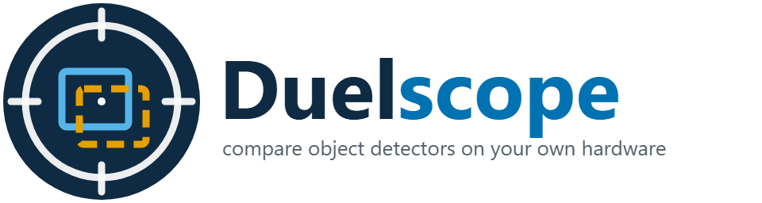
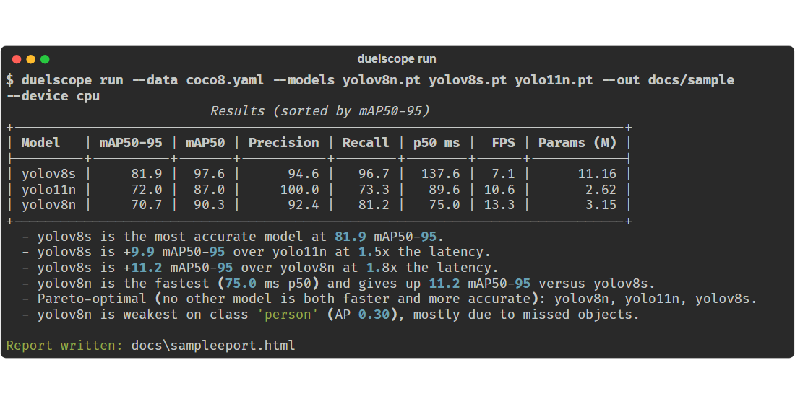
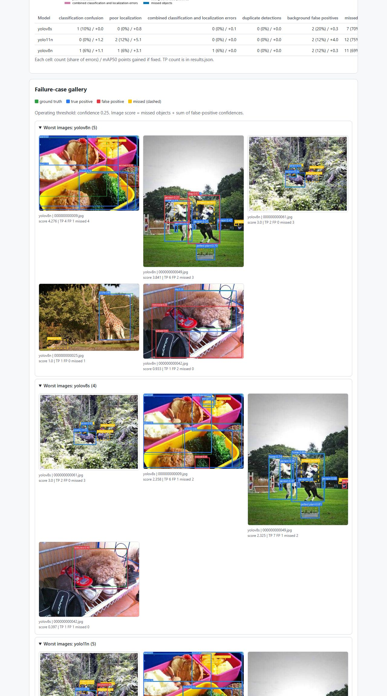
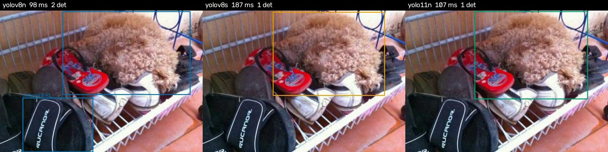

<p align="center"></p>

**One command to compare object detectors: mAP, per-class errors, failure-case gallery, and speed on your own hardware.**

```bash
duelscope run --data path/to/dataset --models yolov8n.pt yolov8s.pt yolo11n.pt --out report/
```

You get one self-contained `report.html` (plus `report.md` and `results.json`): a sortable leaderboard, accuracy-versus-speed with the Pareto frontier, per-class AP heatmap, PR curves, a TIDE-style error taxonomy, annotated failure galleries and the exact hardware the numbers came from. Everything runs locally and offline, on CPU or GPU.



## Quickstart

```bash
pip install "duelscope[all]"                     # or [ultralytics], [onnx], [torchvision], [video]
duelscope doctor                                 # checks Python, CUDA and extras, prints fixes
duelscope run --data coco8.yaml --models yolov8n.pt yolov8s.pt --out report/
```

No dataset handy? `duelscope demo-data demo_dataset` creates a tiny synthetic YOLO dataset.

## Example report

Generated by the command above on `coco8` (its 4 train + 4 val images, so **8 images**: a smoke demo, not a benchmark; these COCO images were also in the models' training data). Hardware: AMD Ryzen 5 3600 (6 cores), 7.9 GB RAM, Windows 10, **CPU only**, PyTorch 2.12, Ultralytics 8.4.82. The full report is in [`docs/sample/`](docs/sample/report.md).

| Model | mAP50-95 | mAP50 | p50 latency (ms, CPU, batch 1) | Params (M) |
|---|---:|---:|---:|---:|
| yolov8s | 81.9 | 97.6 | 137.6 | 11.16 |
| yolo11n | 72.0 | 87.0 | 89.6 | 2.62 |
| yolov8n | 70.7 | 90.3 | 75.0 | 3.15 |




## Video benchmark and quantisation

Two extra commands for deployment questions.

**Side-by-side video** (`pip install "duelscope[video]"`): run several models on one clip, get per-frame latency, FPS, average detections and a *flicker* score (how much the detection count jumps between frames), plus a tiled output video.

```bash
duelscope video-bench --source clip.mp4 --models yolov8n.pt yolov8s.pt yolo11n.pt --out video_report/
```



Real run on a synthetic 80-frame clip built from the 8 `coco8` images (same CPU as above): yolov8n 92 ms p50 (10.8 FPS), yolov8s 174 ms (5.7 FPS), yolo11n 95 ms (10.3 FPS).

**FP32 vs FP16 vs INT8** (`pip install "duelscope[onnx]"`): builds the three ONNX variants of one model (INT8 is static QDQ calibrated on your dataset, with the detection head kept in float), evaluates all of them and adds a quantisation section to the report.

```bash
duelscope quant-compare --data coco8.yaml --model yolov8n.pt --out quant_report/
```

| yolov8n (ONNX, CPU) | mAP50-95 | vs FP32 | p50 ms | Size MB |
|---|---:|---:|---:|---:|
| FP32 | 70.5 | - | 83.1 | 12.3 |
| FP16 | 70.5 | -0.0 | 83.4 | 6.2 |
| INT8 | 61.4 | -9.2 | 88.6 | 6.0 |

Measured on the 8-image `coco8` sample with ONNX Runtime on a Ryzen 5 3600 (CPU only). INT8 halved the file but was not faster on this CPU and cost accuracy; results differ by hardware and dataset, which is exactly why the report exists. See [`docs/sample_quant/`](docs/sample_quant/report.md).

## Features

- **Accuracy**: COCO-style mAP50, mAP50-95, small/medium/large, per-class AP, precision/recall/F1 at the best-F1 threshold, PR curves.
- **Error taxonomy** (simplified TIDE): classification, localization, both, duplicate, background and missed errors, as shares and as the mAP gain if each were fixed.
- **Speed**: warmup, CUDA-synchronised timing, p50/p90/p99 latency with std, FPS at several batch sizes, preprocess/inference/postprocess breakdown, peak GPU memory, RAM, size, parameters.
- **Failure galleries**: worst images per model, "A succeeds where B fails", "every model fails" (label errors?), per-class failures.
- **Deployment checks**: side-by-side video benchmark and FP32/FP16/INT8 comparison.
- **Reproducible**: seeded, hardware and library versions in every report, predictions cached in `.duelscope_cache/`.
- **Adapters**: Ultralytics, ONNX Runtime, torchvision, your own Python class, or third-party plugins.
- **Formats**: YOLO `data.yaml` and COCO JSON, with clear validation messages (`duelscope check-data`).

## Commands

`run`, `check-data`, `report --from results.json`, `compare-reports a.json b.json`, `video-bench`, `quant-compare`, `export` (ONNX), `list-adapters`, `doctor`, `init` (sample config), `demo-data`.

## How is this different?

| | Duelscope | `model.val()` (Ultralytics) | pycocotools / torchmetrics |
|---|---|---|---|
| Compares several models in one report | yes | one model per run | you write the loop |
| Non-Ultralytics models (ONNX, torchvision, custom) | yes | no | yes (you supply predictions) |
| mAP, per-class AP, PR curves | yes | yes | yes |
| Error taxonomy with mAP-gain estimates | simplified TIDE | no | no (see the original TIDE tool) |
| Speed benchmark with hardware info | yes | per-image timing only | no |
| Failure-case gallery | yes | no | no |
| Side-by-side video and FP16/INT8 comparison | yes | no | no |
| Reference implementation of the metric | own, cross-checked | the reference for Ultralytics | the reference for COCO |

Honest caveats: Duelscope uses `predict`-style preprocessing for every model, which is not identical to the rectangular padding inside `model.val()`, so absolute mAP can differ from `val()` (see [docs/metrics.md](docs/metrics.md)). Its metric math is cross-checked against `val()` on the same predictions to about 0.01.

## Docs

[Adapters guide](docs/adapters.md) | [Metrics](docs/metrics.md) | [Benchmarking methodology](docs/benchmarking.md) | [FAQ](docs/faq.md) | [Roadmap](docs/ROADMAP.md) | [Design decisions](docs/DECISIONS.md)

## Roadmap and contributing

See [docs/ROADMAP.md](docs/ROADMAP.md) for good first issues (RT-DETR, YOLOX, EfficientDet adapters, COCO-JSON export, an HTML theme switcher). Read [CONTRIBUTING.md](CONTRIBUTING.md); development is `pip install -e ".[dev]" && pytest && ruff check .`.

MIT licensed.
