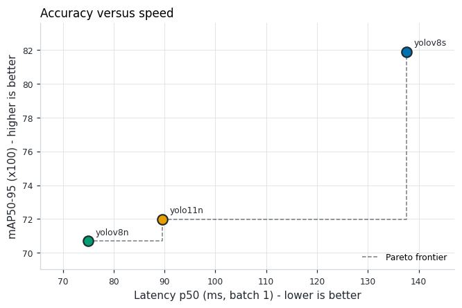
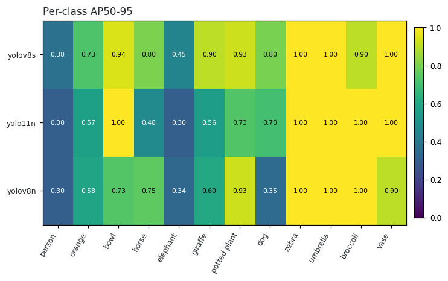
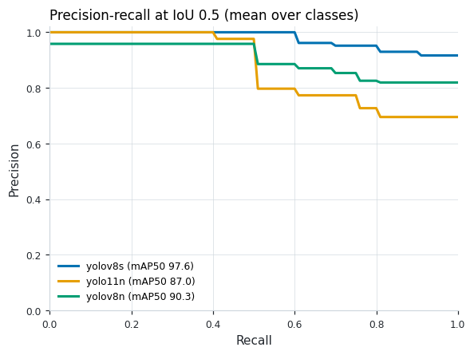
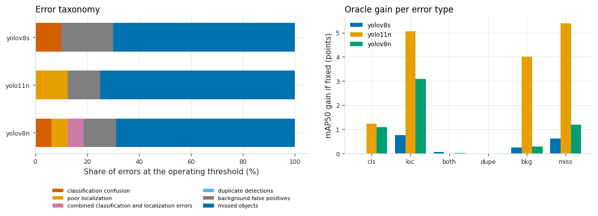

# Duelscope report: coco8 (train+val)

8 images, 30 boxes, 80 classes (split `val`). Generated 2026-11-16T10:18:51+00:00 with Duelscope 0.1.0.

## Summary

| Model | mAP50-95 | mAP50 | Precision | Recall | p50 ms | FPS | Params (M) | Size (MB) |
|---|---:|---:|---:|---:|---:|---:|---:|---:|
| yolov8s | 81.9 | 97.6 | 94.6 | 96.7 | 137.6 | 7.1 | 11.16 | 21.5 |
| yolo11n | 72.0 | 87.0 | 100.0 | 73.3 | 89.6 | 10.6 | 2.62 | 5.3 |
| yolov8n | 70.7 | 90.3 | 92.4 | 81.2 | 75.0 | 13.3 | 3.15 | 6.2 |

## Key findings

- yolov8s is the most accurate model at 81.9 mAP50-95.
- yolov8s is +9.9 mAP50-95 over yolo11n at 1.5x the latency.
- yolov8s is +11.2 mAP50-95 over yolov8n at 1.8x the latency.
- yolov8n is the fastest (75.0 ms p50) and gives up 11.2 mAP50-95 versus yolov8s.
- Pareto-optimal (no other model is both faster and more accurate): yolov8n, yolo11n, yolov8s.
- yolov8n is weakest on class 'person' (AP 0.30), mostly due to missed objects.
- For yolov8n, fixing poor localization would add the most (+3.1 mAP50).
- yolov8s is weakest on class 'person' (AP 0.38), mostly due to missed objects.
- For yolov8s, fixing poor localization would add the most (+0.8 mAP50).
- yolo11n is weakest on class 'person' (AP 0.30), mostly due to missed objects.
- For yolo11n, fixing missed objects would add the most (+5.4 mAP50).

## Charts

## Failure cases

Operating confidence 0.25.

**Worst images, yolov8n:** [000000000009.jpg](gallery/yolov8n/00000_000000000009.jpg), [000000000049.jpg](gallery/yolov8n/00006_000000000049.jpg), [000000000061.jpg](gallery/yolov8n/00007_000000000061.jpg), [000000000025.jpg](gallery/yolov8n/00001_000000000025.jpg), [000000000042.jpg](gallery/yolov8n/00005_000000000042.jpg)

**Worst images, yolov8s:** [000000000061.jpg](gallery/yolov8s/00007_000000000061.jpg), [000000000009.jpg](gallery/yolov8s/00000_000000000009.jpg), [000000000049.jpg](gallery/yolov8s/00006_000000000049.jpg), [000000000042.jpg](gallery/yolov8s/00005_000000000042.jpg)

**Worst images, yolo11n:** [000000000061.jpg](gallery/yolo11n/00007_000000000061.jpg), [000000000009.jpg](gallery/yolo11n/00000_000000000009.jpg), [000000000049.jpg](gallery/yolo11n/00006_000000000049.jpg), [000000000025.jpg](gallery/yolo11n/00001_000000000025.jpg), [000000000042.jpg](gallery/yolo11n/00005_000000000042.jpg)

**yolov8s ok, yolov8n fails:** [000000000025.jpg](gallery/yolov8n/00001_000000000025.jpg)

**yolov8s ok, yolo11n fails:** [000000000025.jpg](gallery/yolo11n/00001_000000000025.jpg)

**Hard for every model (check labels):** [000000000009.jpg](gallery/yolov8n/00000_000000000009.jpg), [000000000061.jpg](gallery/yolov8n/00007_000000000061.jpg), [000000000049.jpg](gallery/yolov8n/00006_000000000049.jpg)

## Hardware

- CPU: AMD Ryzen 5 3600 6-Core Processor (6 cores / 12 threads)
- RAM: 7.9 GB
- GPU: NVIDIA GeForce GTX 1050 (2048 MB); PyTorch CUDA usable: no
- OS: Windows-10-10.0.19045-SP0; Python 3.14.4
- Libraries: duelscope 0.1.0, numpy 2.4.5, torch 2.12.0, torchvision 0.27.0, ultralytics 8.4.82, onnxruntime 1.26.0, pillow 12.2.0

Settings: `imgsz=640`, `eval_conf=0.001`, `display_conf=0.25`, `nms_iou=0.6`, `device=cpu`, `batch=8`, `max_images=None`, `seed=0`, `speed_images=8`
