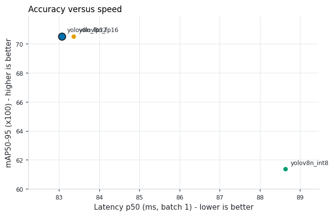
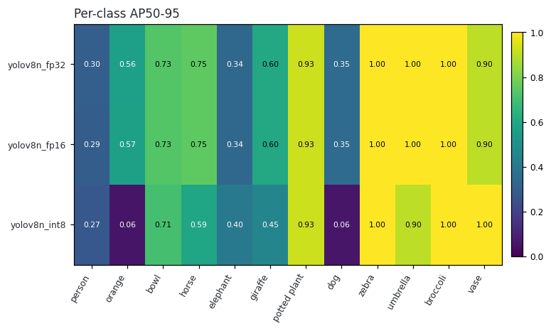
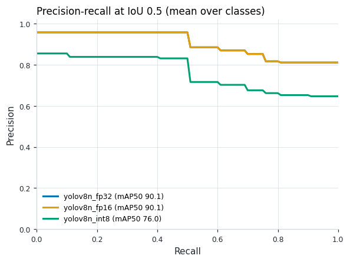
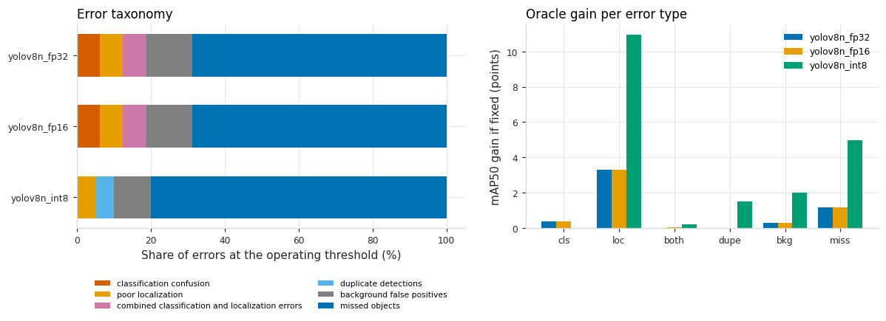

# Duelscope report: coco8 (train+val)

8 images, 30 boxes, 80 classes (split `val`). Generated 2026-11-16T10:51:31+00:00 with Duelscope 0.1.0.

## Summary

| Model | mAP50-95 | mAP50 | Precision | Recall | p50 ms | FPS | Params (M) | Size (MB) |
|---|---:|---:|---:|---:|---:|---:|---:|---:|
| yolov8n_fp32 | 70.5 | 90.1 | 92.4 | 81.2 | 83.1 | 11.6 | - | 12.3 |
| yolov8n_fp16 | 70.5 | 90.1 | 92.4 | 81.2 | 83.4 | 11.5 | - | 6.2 |
| yolov8n_int8 | 61.4 | 76.0 | 93.1 | 68.9 | 88.6 | 11.4 | - | 6.0 |

## Key findings

- FP16 changes mAP50-95 by -0.0 and is 2.0x smaller and is 1.00x slower versus FP32 on this hardware.
- INT8 changes mAP50-95 by -9.2 and is 2.0x smaller and is 1.07x slower versus FP32 on this hardware.
- yolov8n_fp32 is the most accurate model at 70.5 mAP50-95.
- yolov8n_fp32 is +0.0 mAP50-95 over yolov8n_fp16 at similar latency.
- yolov8n_fp32 is +9.2 mAP50-95 over yolov8n_int8 and is also 1.1x faster.
- Pareto-optimal (no other model is both faster and more accurate): yolov8n_fp32.
- yolov8n_fp32 is weakest on class 'person' (AP 0.30), mostly due to missed objects.
- For yolov8n_fp32, fixing poor localization would add the most (+3.3 mAP50).
- yolov8n_fp16 is weakest on class 'person' (AP 0.29), mostly due to missed objects.
- For yolov8n_fp16, fixing poor localization would add the most (+3.3 mAP50).
- yolov8n_int8 is weakest on class 'orange' (AP 0.06), mostly due to missed objects.
- For yolov8n_int8, fixing poor localization would add the most (+11.0 mAP50).

## Quantisation

| Variant | Precision | mAP50-95 | Delta | p50 ms | Speedup | Size MB | Smaller |
|---|---|---:|---:|---:|---:|---:|---:|
| yolov8n_fp32 | FP32 | 70.5 | +0.0 | 83.1 | 1.00x | 12.3 | 1.0x |
| yolov8n_fp16 | FP16 | 70.5 | -0.0 | 83.4 | 1.00x | 6.2 | 2.0x |
| yolov8n_int8 | INT8 | 61.4 | -9.2 | 88.6 | 0.94x | 6.0 | 2.0x |

## Charts

## Hardware

- CPU: AMD Ryzen 5 3600 6-Core Processor (6 cores / 12 threads)
- RAM: 7.9 GB
- GPU: NVIDIA GeForce GTX 1050 (2048 MB); PyTorch CUDA usable: no
- OS: Windows-10-10.0.19045-SP0; Python 3.14.4
- Libraries: duelscope 0.1.0, numpy 2.5.5, torch 2.12.0, torchvision 0.27.0, ultralytics 8.4.82, onnxruntime 1.26.0, pillow 12.2.0

Settings: `imgsz=640`, `eval_conf=0.001`, `display_conf=0.25`, `nms_iou=0.6`, `device=cpu`, `batch=8`, `max_images=None`, `seed=0`, `speed_images=8`
